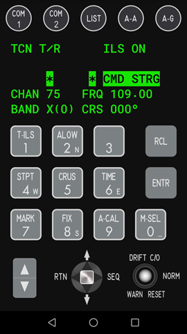
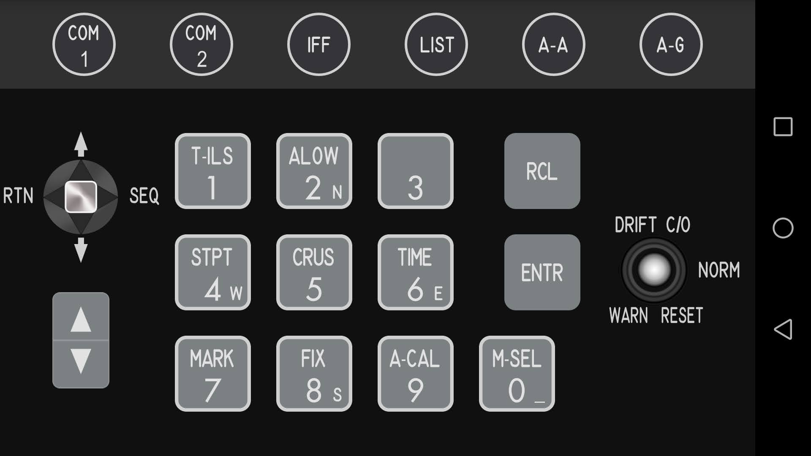
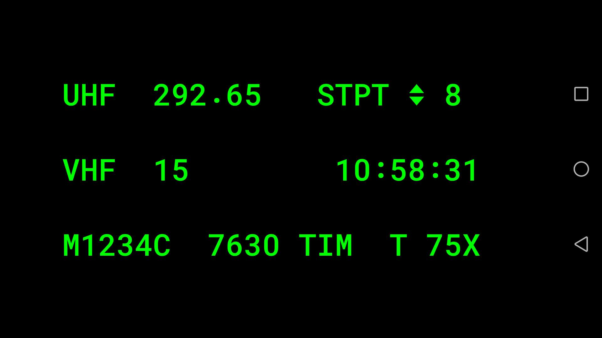
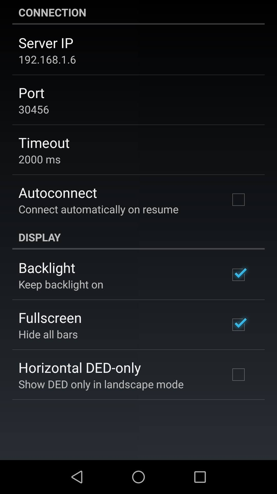

# Falcon ICP

Falcon ICP is provides a virtual F-16 ICP keyboard integrated with a DED display, allowing to improve your experience with [Falcon BMS flight simulator](https://www.falcon-bms.com/).
It consists of two components:
* Falcon ICP Server application for Windows systems
* Falcon ICP Android application

## Android Application

The Falcon ICP application can operate in vertical or horizontal orientation.

### Vertical mode

In vertical mode DED is integrated with ICP on one view.

### Horizonal mode

In horizontal mode choose between ICP or DED:

### Settings

On the first run the Settings screen opens automatically.
Configure the Server IP address. The default port is 30456.

