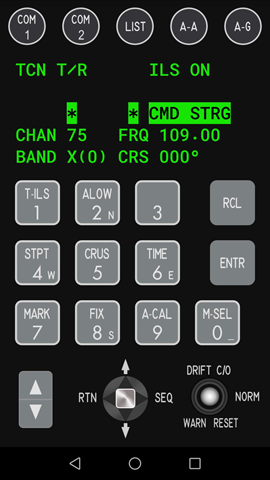
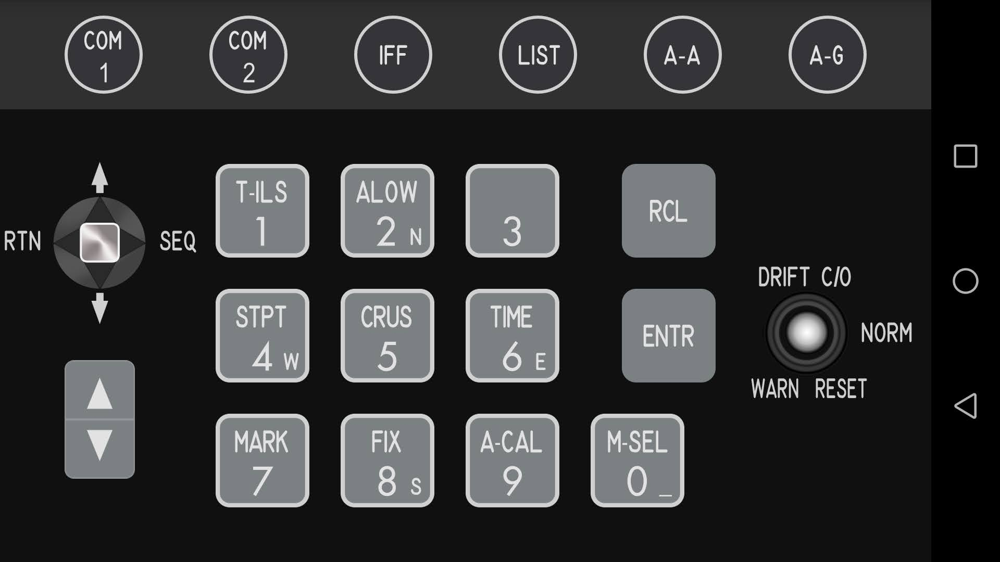
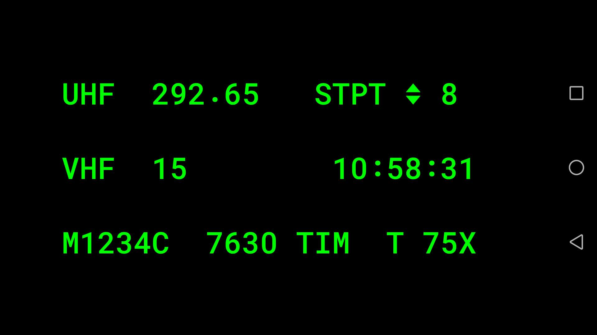
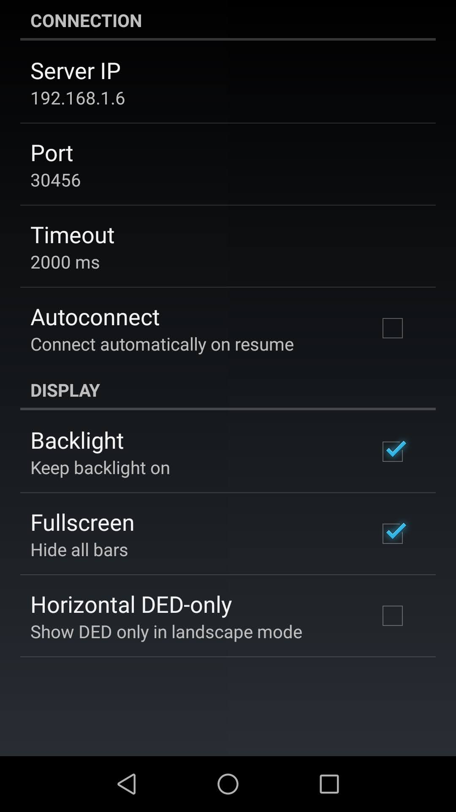

# Falcon ICP

Falcon ICP is provides a virtual F-16 ICP keyboard integrated with a DED display, allowing to improve your experience with [Falcon BMS flight simulator](https://www.falcon-bms.com/).
It consists of two components:
* Falcon ICP Server application for Windows systems
* Falcon ICP Android application

## Android Application

The Falcon ICP application can operate in vertical or horizontal orientation.

### Vertical mode

In vertical mode DED is integrated with ICP on one view.

### Horizonal mode

In horizontal mode choose between ICP or DED:

### Settings

On the first run the Settings screen opens automatically.
Configure the Server IP address. The default port is 30456.

## Server application

### Download

Latest release: [Falcon ICP Server v1.0.0](https://github.com/falconicp/main/releases/download/v1.0.0/FalconICPServer-1.0.0.zip)

### Install

The server application is fully portable. Just unpack the zip file and run `Falcon ICP Server.exe`.

### Upgrade

If you have an older version installed, remove all files are unpack the new zip file.

### Setup

1. After starting the application pick the keyfile you use in Falcon BMS
2. Configure keyboard mappings for all ICP buttons
3. Not your server local IP address and configure it in the Android app
4. Click `Start server`. The Android app should now be able to connect.